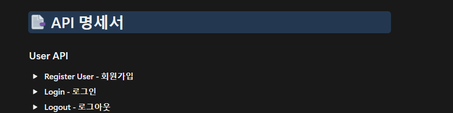
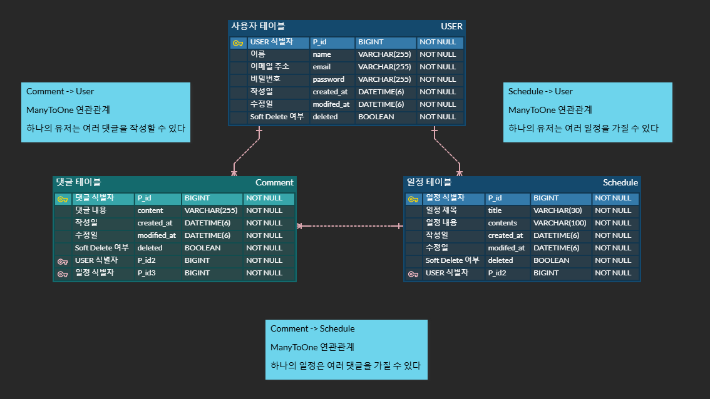

# 📅 일정 관리 앱 Develop 

Spring Boot와 Spring Data JPA를 활용한 일정 및 사용자 관리 Part 2 구현!

### Entities & 연관관계
> `@ManyToOne`을 활용한 단방향 연관관계 매핑
- 사용자 관리: 사용자 CRUD 구현 
- 일정 관리: 일정 CRUD 구현
- 댓글 관리: 댓글 CRUD 구현 

### 주요 기능
- 로그인 및 세션 관리: 로그인 요청을 통한 사용자 인증 + sessionUser 관리 (Cookie/Session)
- Soft Delete: 데이터를 실제로 삭제하지 않고 삭제 여부를 기록 (Deleted = false/true)
- 페이지네이션: 페이지 번호와 페이지 크기를 사용하여 일정 목록을 조회
- 3-Layer Architecture 구조: Controller, Service, Repository

 

#### 📚 프로젝트 기록: [Velog - 프로젝트 개발 기록 및 학습 내용](https://velog.io/@juhan913/posts)

---------------
 

---

## 📑 API 명세서

---

#### Documentation: [Notion - 일정 관리 Develop API 명세서 ](https://bolder-shrimp-6f4.notion.site/Develop-API-402df7a8441c80ff9729d4e83ea973f1)

-----------

## 🗺️ ERD

